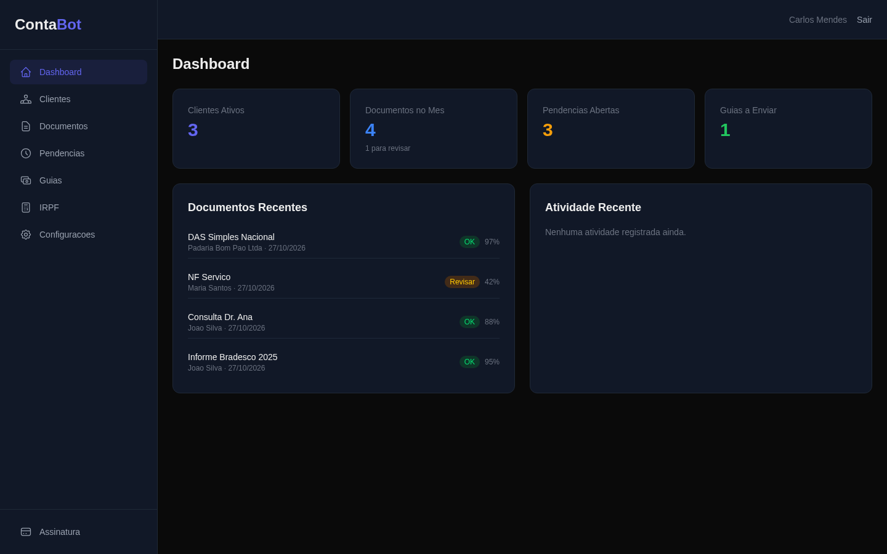
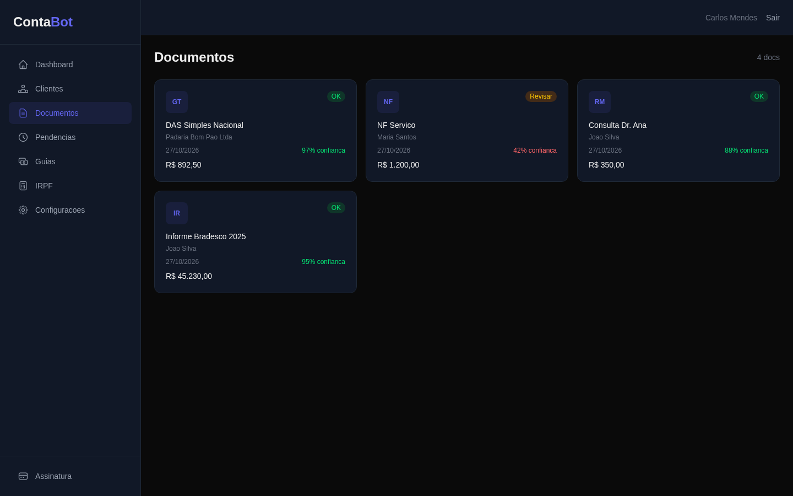
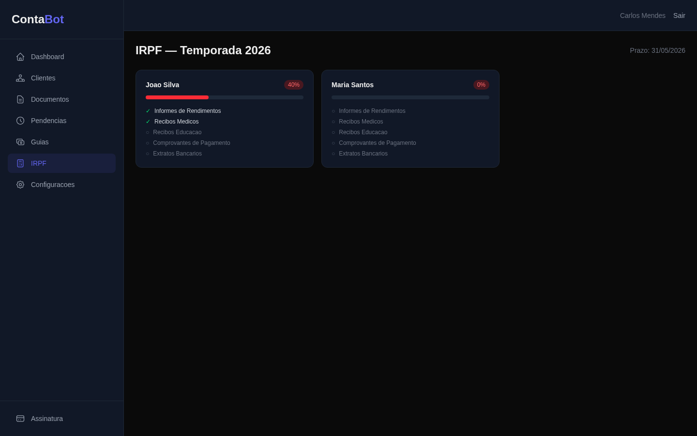
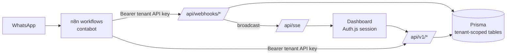

# ContaBot SaaS — multi-tenant dashboard for accounting firms


The web side of [ContaBot](https://github.com/Sataker/contabot). The n8n workflows handle WhatsApp and the LLM;
this app is where each accounting firm sees and manages what the automation did: clients, classified documents,
tax payment slips, pending items and the income-tax (IRPF) season. One deployment serves many firms. Every row
belongs to a tenant, and every query is scoped by it.



| Documents with extraction confidence | IRPF checklist per client |
|---|---|
|  |  |

## Features

- **Dashboard** — active clients, documents this month (and how many need review), open pending items, slips to send.
- **Documents** — everything the WhatsApp bot classified, with the model's confidence score; low-confidence items are
  flagged *Revisar*.
- **Slips (guias) and pending items** — what has to go to each client and the reminder history.
- **IRPF season** — per-client progress against the required document list.
- **Settings** — WhatsApp instance (UazAPI) with QR-code connection, per-firm Google Drive via OAuth, office hours and
  reminder cadence.
- **Live updates** — new documents and clients appear without a refresh (Server-Sent Events).

## How it fits with the automation



- **Two ways in, one tenant rule.** The dashboard authenticates with an Auth.js session (credentials, JWT strategy).
  n8n authenticates with a per-tenant API key (`Authorization: Bearer <key>`). Both resolve to a `tenantId`, and every
  read and write filters on it.
- **Tenant-scoped schema.** `tenantId` on every model, compound indexes such as `(tenantId, status)` and
  `(tenantId, receivedAt)`, and `@@unique([tenantId, cpfCnpj])` so two firms can have the same client.
- **Server-owned fields stay server-owned.** PATCH handlers accept an explicit allow-list of fields; `tenantId`, `id`
  and other columns can't be written from a request body, and a document can only be linked to a client of the same
  tenant.

## API

All `/api/v1` and `/api/webhooks` routes accept the tenant API key; `/api/v1` routes also accept the dashboard session.

| Method | Route | Purpose |
|--------|-------|---------|
| `GET` `POST` | `/api/v1/clientes` | List / create clients |
| `GET` | `/api/v1/clientes/buscar` | Find a client (e.g. by WhatsApp number) |
| `GET` `PATCH` | `/api/v1/clientes/[id]` | Client detail with documents, pending items and slips / update |
| `GET` `POST` | `/api/v1/documentos` | List / create documents |
| `GET` `PATCH` | `/api/v1/documentos/[id]` | Document detail / update (logged to the activity feed) |
| `GET` `POST` | `/api/v1/guias` · `GET` `/api/v1/guias/pendentes` · `PATCH` `/api/v1/guias/[id]` | Slips and their send/paid status |
| `GET` `POST` | `/api/v1/pendencias` · `PATCH` `/api/v1/pendencias/[id]` | Pending items and reminder state |
| `GET` `PUT` | `/api/v1/config` | Firm settings |
| `GET` `POST` | `/api/v1/whatsapp` | Instance status / QR code |
| `GET` | `/api/v1/drive/auth` · `/api/v1/drive/callback` · `POST` `/api/v1/drive/disconnect` | Google Drive OAuth per firm |
| `GET` | `/api/v1/activity` | Activity feed |
| `POST` | `/api/webhooks/intake` | n8n posts a classified document |
| `POST` | `/api/webhooks/qa` | n8n asks for client context before answering on WhatsApp |
| `POST` | `/api/webhooks/cadastro` | n8n registers a new client |
| `GET` | `/api/sse` | Live event stream for the dashboard |

Example (the seeded tenant's API key is printed by `npx prisma studio`, table `tenants`):

```bash
curl -s http://localhost:3100/api/v1/clientes -H "Authorization: Bearer $TENANT_API_KEY"
```

## Run locally

Requires Node.js 20+. The local database is SQLite, so there is nothing else to install.

```bash
npm install
cp .env.example .env        # set NEXTAUTH_SECRET / AUTH_SECRET (openssl rand -base64 32)
npm run db:push             # create the schema
npm run db:seed             # demo firm, clients, documents, slips
npm run dev                 # http://localhost:3100
```

Log in with `admin@contabot.com` / `admin123` (demo data only).

Checks: `npm run typecheck`, `npm run lint`, `npm run build`.

## Project structure

```
src/
  app/
    (auth)/login/           # sign-in page
    (dashboard)/            # dashboard, clientes, documentos, guias, pendencias, irpf, configuracoes, assinatura
    api/v1/                 # REST API (session or tenant API key)
    api/webhooks/           # endpoints called by n8n
    api/sse/                # Server-Sent Events stream
  components/dashboard/     # shell, sidebar, topbar, stat cards
  lib/                      # auth (Auth.js), api-auth (tenant key), prisma, sse, pick (field allow-list)
prisma/
  schema.prisma             # Tenant, User, Client, Document, Pendencia, Guia, ActivityLog
  seed.ts
```

## Known limitations

- Live updates use an in-memory event bus, so they reach dashboards connected to the same server process; running
  several instances needs a shared bus (e.g. Redis pub/sub or PostgreSQL `LISTEN/NOTIFY`).
- The subscription page (`/assinatura`) is UI only; billing is not wired.
- The schema uses only portable column types; production on PostgreSQL means switching `provider` in `schema.prisma` and running a migration.

## License

[MIT](./LICENSE) © Enzo Vaccaro
